# TapChanger

[Catalog row](../../README.md#tapchanger) · [Gallery](../../GALLERY.md)

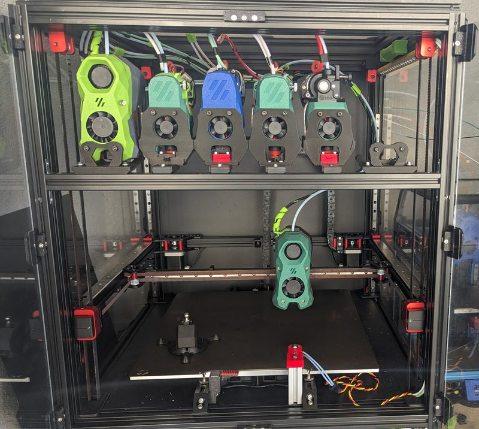

| Field | Value |
| --- | --- |
| Section | Tool changers |
| Project page | [https://github.com/viesturz/tapchanger](https://github.com/viesturz/tapchanger) |
| Author | viesturz |
| About | Kinematic shuttle: the tool rides on bearings and rods. No servos and no wires on the shuttle. An optional lift bar dock adds static-gantry printers. |
| Coupling | bearings on rods |
| Lock | magnets |
| Extruder | on the tool |
| Change time | [~5-7 s](https://www.youtube.com/watch?v=IVhQJohzZ84) |
| Tools | 6 |
| Printer | CoreXY, any gantry |
| Firmware | Klipper, klipper-toolchanger |
| Latest version | V4.3 [2024-06](https://github.com/viesturz/tapchanger/commit/da002c4bdac88759e0f119470014cb8955da5879) |
| Stars Likes Views |  [⏯️⁠54.8K](https://www.youtube.com/watch?v=EnS93NUZhsY) |
| Links | [STL](https://github.com/viesturz/tapchanger/tree/main/Tapchanger/STL) [CAD](https://github.com/viesturz/tapchanger/tree/main/Tapchanger/CAD) [BOM](https://github.com/viesturz/tapchanger/blob/main/Tapchanger/BOM.md) [Manual](https://github.com/viesturz/tapchanger/blob/main/Tapchanger/Assembly.md) [Config](https://github.com/viesturz/tapchanger/tree/main/Klipper) [Video](https://www.youtube.com/playlist?list=PLqU7kX5nUJDRDw5z0NLwJ22OkV6fbjnSW) |
| Groups | [Discord](https://discord.gg/xmDWrYGwVJ) EN 2.2K |

## Pictures (12)

<table>
<tr><td align="center" width="33%"> Photo: <a href="https://github.com/viesturz/tapchanger">viesturz</a></td><td align="center" width="33%"><a href="1-tapchanger.jpg">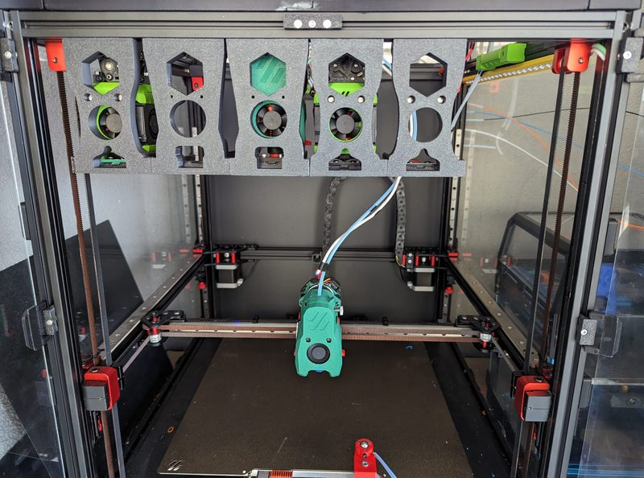</a> Photo: <a href="https://github.com/viesturz/tapchanger">viesturz</a></td><td align="center" width="33%"><a href="2-tapchanger.jpg">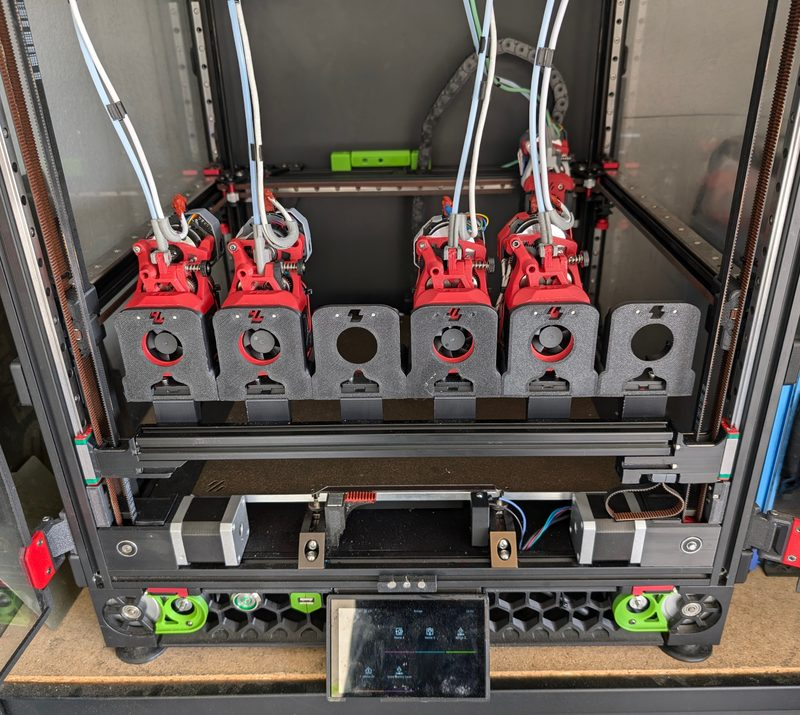</a> Photo: <a href="https://github.com/viesturz/tapchanger">viesturz</a></td></tr>
<tr><td align="center" width="33%"><a href="3-tapchanger.jpg">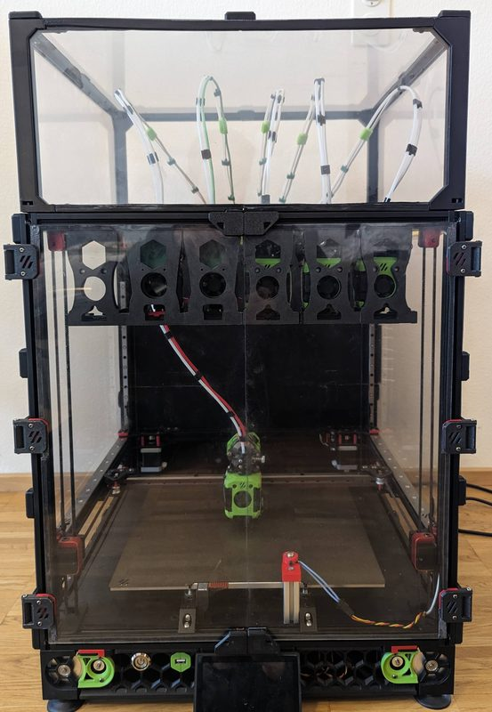</a> Photo: <a href="https://github.com/viesturz/tapchanger">viesturz</a></td><td align="center" width="33%"><a href="4-tapchanger.jpg">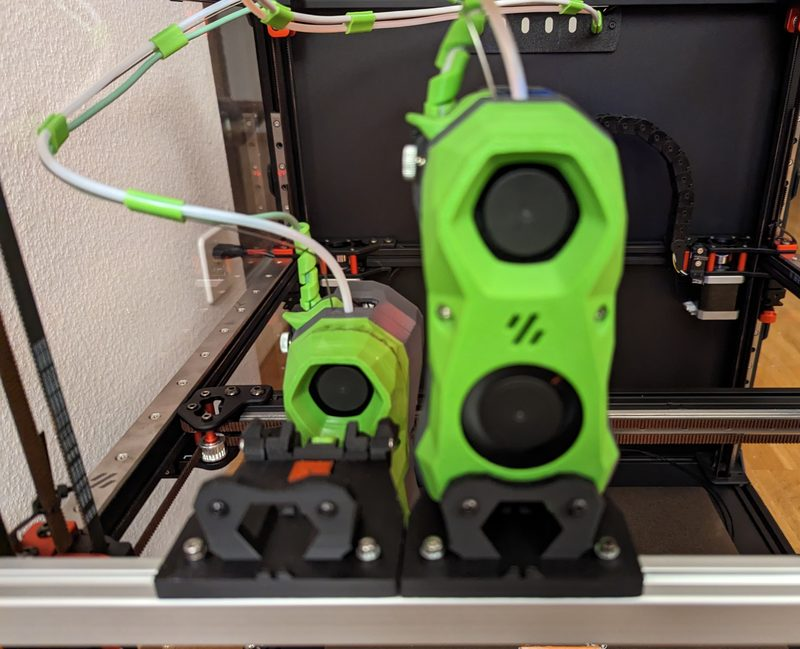</a> Photo: <a href="https://github.com/viesturz/tapchanger">viesturz</a></td><td align="center" width="33%"><a href="5-tapchanger.jpg">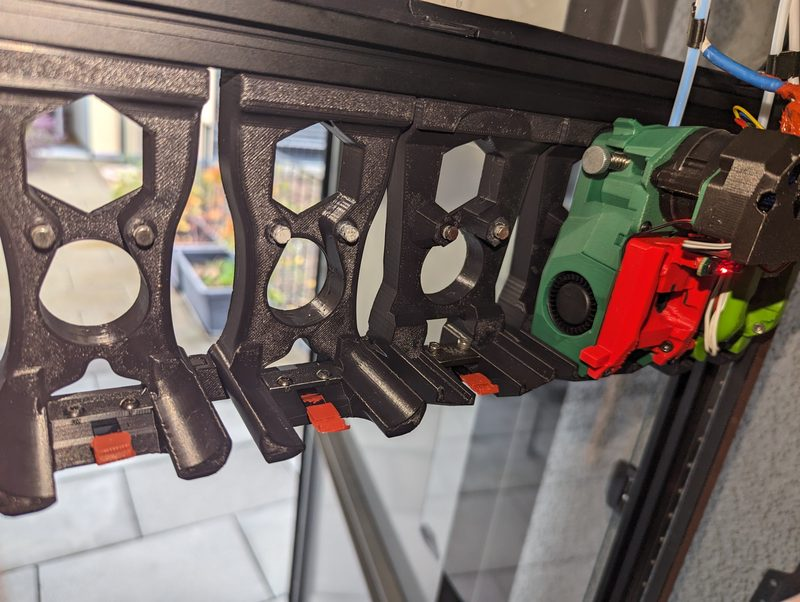</a> Photo: <a href="https://github.com/viesturz/tapchanger">viesturz</a></td></tr>
<tr><td align="center" width="33%"><a href="6-tapchanger.jpg">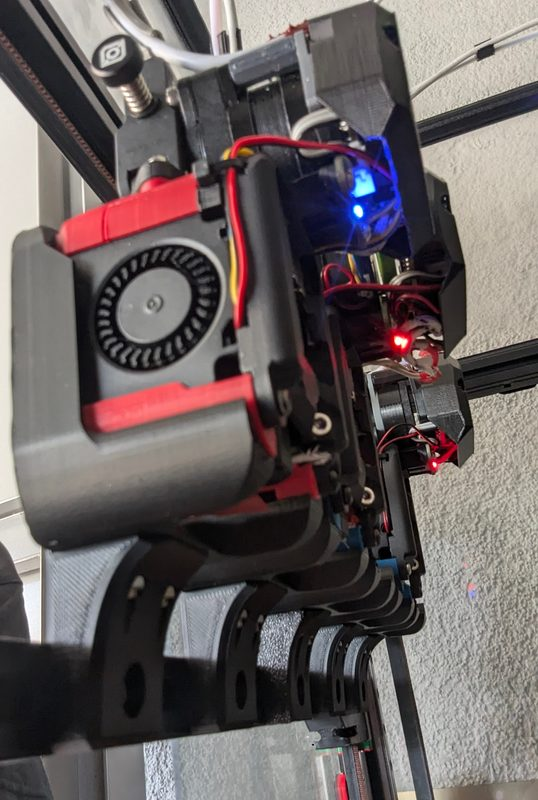</a> Photo: <a href="https://github.com/viesturz/tapchanger">viesturz</a></td><td align="center" width="33%"><a href="7-tapchanger.jpg">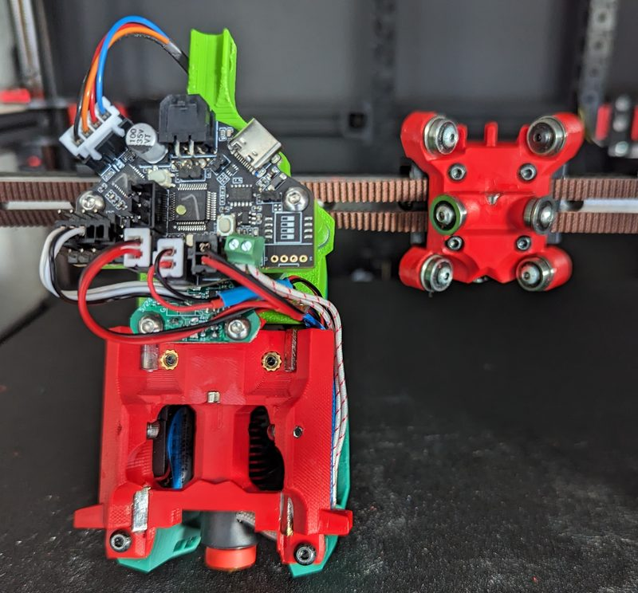</a> Photo: <a href="https://github.com/viesturz/tapchanger">viesturz</a></td><td align="center" width="33%"><a href="8-tapchanger.jpg">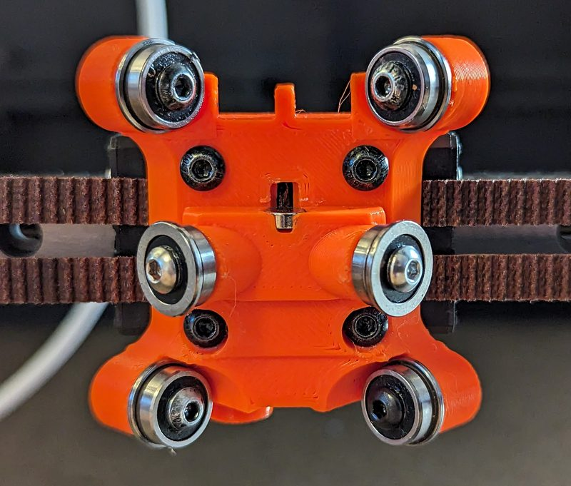</a> Photo: <a href="https://github.com/viesturz/tapchanger">viesturz</a></td></tr>
<tr><td align="center" width="33%"><a href="9-tapchanger.jpg">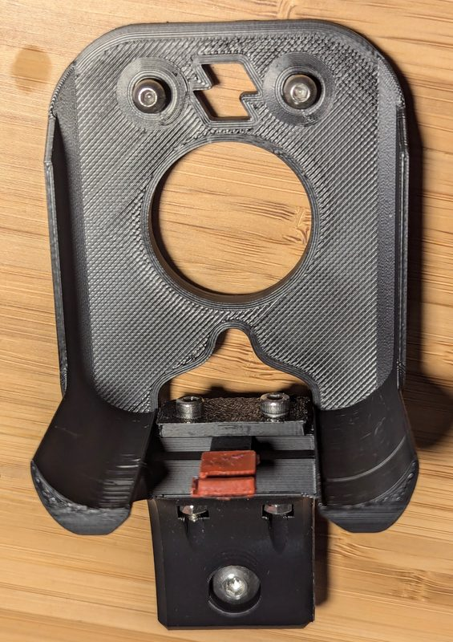</a> Photo: <a href="https://github.com/viesturz/tapchanger">viesturz</a></td><td align="center" width="33%"><a href="10-tapchanger.jpg">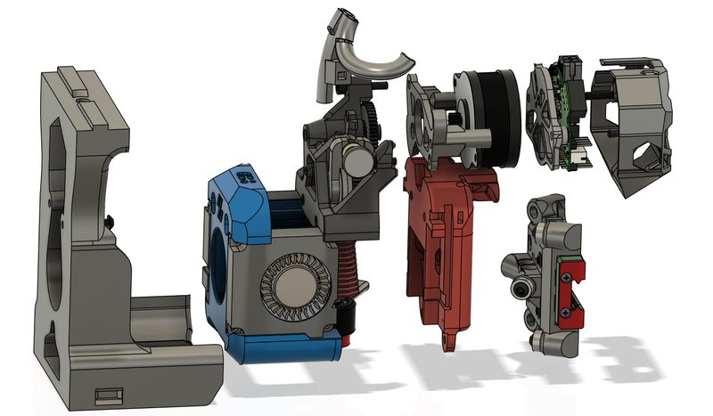</a> Photo: <a href="https://github.com/viesturz/tapchanger">viesturz</a></td><td align="center" width="33%"><a href="11-tapchanger.jpg">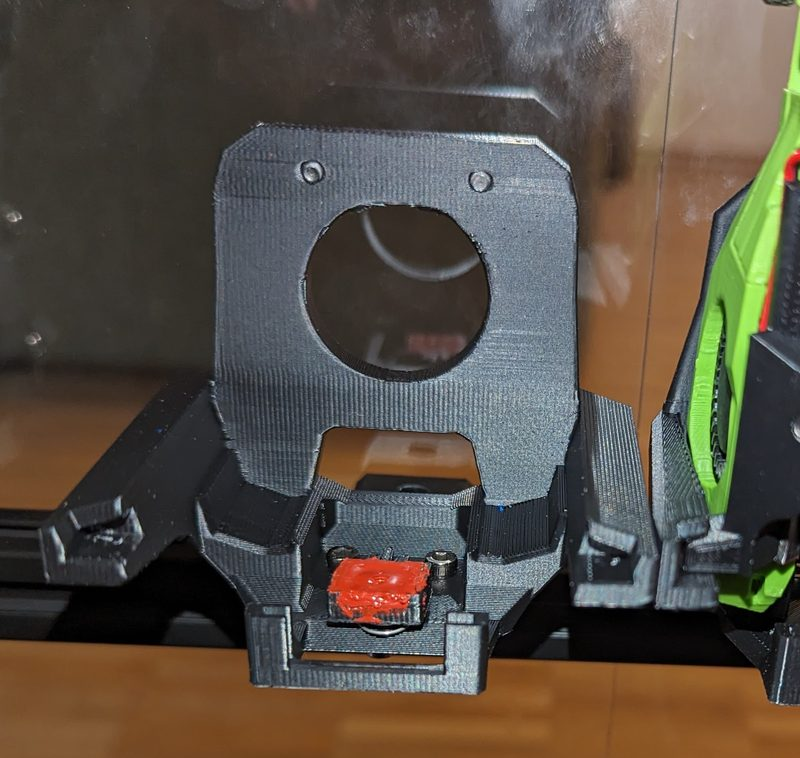</a> Photo: <a href="https://github.com/viesturz/TapChanger-lite">viesturz</a></td></tr>
</table>

## Notes

- The tool has about 4 mm of vertical travel on the shuttle, so with an OptoTap sensor each tool is also a nozzle probe. ([source](https://github.com/viesturz/tapchanger))
- Printers that the author names: Voron 2.4, Voron Trident. ([source](https://github.com/viesturz/tapchanger))
- With Dragon Burner toolheads, 6 hotends fit on a 350 mm frame. ([source](https://github.com/viesturz/tapchanger))
- The shuttle comes in three versions: steel plates, round rods, and square rods. ([source](https://github.com/viesturz/tapchanger))
- Since V2.3 the nozzle pads are spring steel, so they no longer melt. ([source](https://github.com/viesturz/tapchanger))
