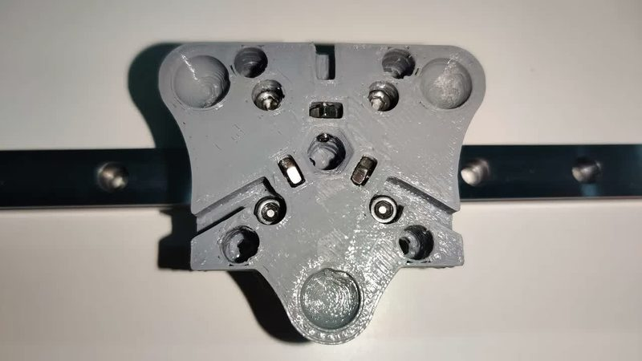
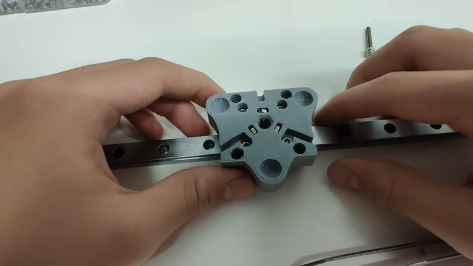

# Terry Tao toolchanger

[Catalog row](../../OTHER.md#terry-tao-toolchanger) · [Gallery](../../GALLERY.md)

| Field | Value |
| --- | --- |
| Section | Concepts and prototypes ([OTHER.md](../../OTHER.md)) |
| Project page | [https://www.youtube.com/watch?v=HsSOVnam678](https://www.youtube.com/watch?v=HsSOVnam678) |
| Author | Terry Tao |
| About | A 2020 toolchanger carriage with a detent and pin locking mechanism. The author abandoned it before finishing the printer. |
| Type | Tool changer |
| Status | Idea, abandoned |
| Coupling | pins |
| Lock | detent |
| Latest version | Last seen [2020-11](https://www.youtube.com/watch?v=HsSOVnam678) |
| Stars Likes Views | [⏯️⁠478](https://www.youtube.com/watch?v=HsSOVnam678) |
| Links | [Video](https://www.youtube.com/watch?v=HsSOVnam678) |

## Pictures (2)

<table>
<tr><td align="center" width="33%"> Photo: <a href="https://www.youtube.com/watch?v=HsSOVnam678">Terry Tao</a></td><td align="center" width="33%"> Photo: <a href="https://www.youtube.com/watch?v=HsSOVnam678&amp;t=56s">Terry Tao</a></td></tr>
</table>
