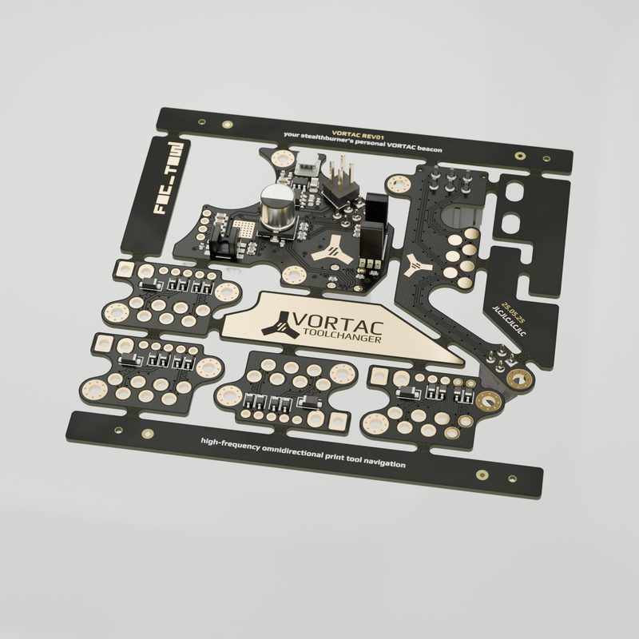

# VORTAC Toolchanger

[Catalog row](../../OTHER.md#toolchanger-development-foctow) · [Gallery](../../GALLERY.md)

| Field | Value |
| --- | --- |
| Section | Concepts and prototypes ([OTHER.md](../../OTHER.md)) |
| Project page | [https://github.com/VortacDesign/VortacToolchanger](https://github.com/VortacDesign/VortacToolchanger) |
| Author | VortacDesign (FoCTow, HenrikH96) |
| About | Stealthburner-based toolchanger with a carriage PCB and per-tool plate PCBs that connect through Mill-Max spring pogo contacts. A hook turned by a stepper locks the tool, and opto sensors on the carriage board read the tool and lock state. |
| Type | Tool changer |
| Status | PCB, STL and firmware, no CAD of the mechanics |
| Coupling | — |
| Lock | hook, stepper |
| Latest version | Files [2026-04](https://github.com/VortacDesign/VortacToolchanger/commit/f813cc8) |
| Stars Likes Views |  |
| Links | [PCB](https://github.com/VortacDesign/VortacToolchanger/tree/main/pcb) [STL](https://github.com/VortacDesign/VortacToolchanger/tree/main/stl) [FW](https://github.com/VortacDesign/VortacFirmware) |

## Pictures (1)

<table>
<tr><td align="center" width="33%"> Photo: <a href="https://github.com/FoCTow/ToolchangerDevelopment/tree/main/PCB/Render">FoCTow</a></td></tr>
</table>
