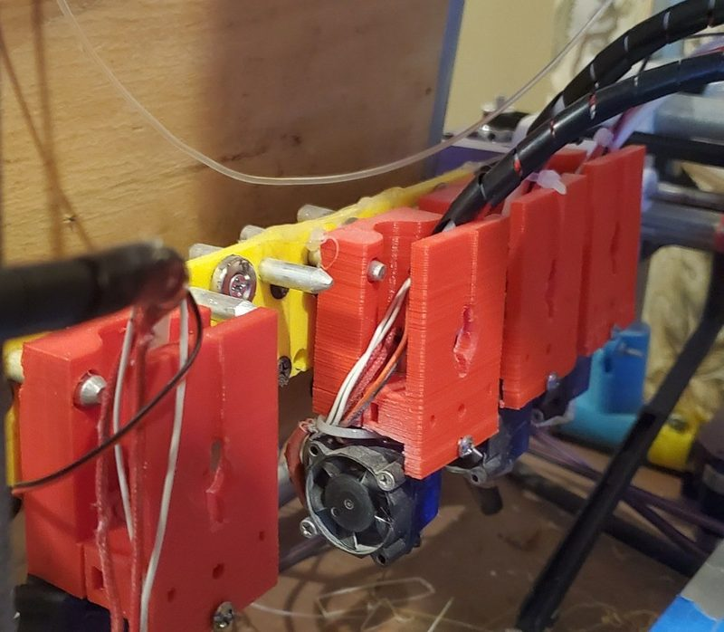
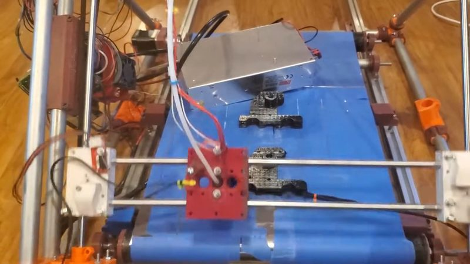
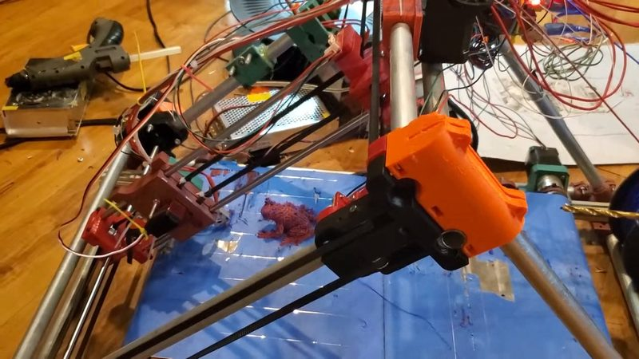
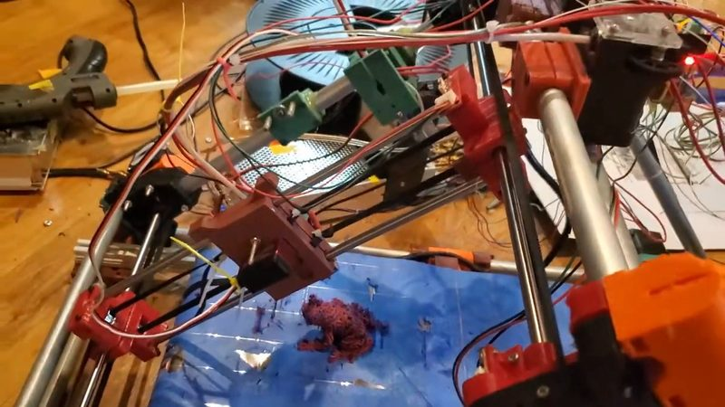
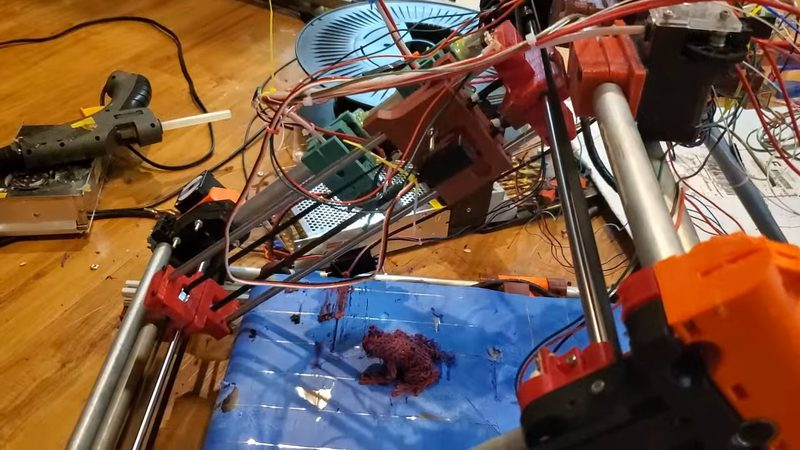
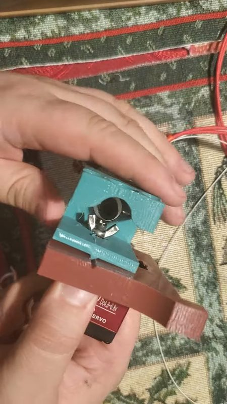
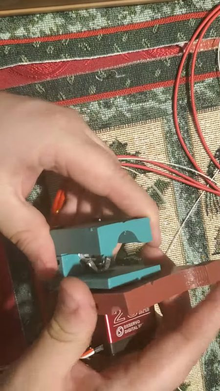

# toolchanger2

[Catalog row](../../OTHER.md#toolchanger2) · [Gallery](../../GALLERY.md)

| Field | Value |
| --- | --- |
| Section | Legacy designs ([OTHER.md](../../OTHER.md)) |
| Project page | [https://github.com/RobMink/toolchanger2](https://github.com/RobMink/toolchanger2) |
| Author | Rob Mink (Printcepts) |
| About | Large tool changer based on Alex's Piper 2. A servo on the carriage side locks the tool. Heads include J-head print tools, a laser and a CNC head, with per-tool Klipper activate/deactivate G-code. No update since 2021-11. |
| Type | Tool changer, Bowden |
| Coupling | — |
| Lock | servo lock |
| Change time | — |
| Latest version | Update [2021-11](https://www.thingiverse.com/thing:5100796) |
| Stars Likes Views |  [⏯️⁠4.1K](https://www.youtube.com/watch?v=2u0d4myZtUk) |
| Links | [STL](https://github.com/RobMink/toolchanger2) [Config](https://github.com/RobMink/toolchanger2/blob/master/printer.cfg) [Video](https://www.youtube.com/watch?v=C4KVxfeMUEw) |
| Groups | [Discord](https://discord.gg/nVmeNJJSH2) EN 888 |

## Pictures (8)

<table>
<tr><td align="center" width="33%"> Photo: <a href="https://www.thingiverse.com/thing:4394563">Rob Mink (Printcepts)</a></td><td align="center" width="33%"> Photo: <a href="https://www.thingiverse.com/thing:4394563">Rob Mink (Printcepts)</a></td><td align="center" width="33%"> Version: Piper 4 (Infinity) with tool changing Photo: <a href="https://www.youtube.com/watch?v=uYj4rv-w3oQ">Rob Mink</a></td></tr>
<tr><td align="center" width="33%"> Version: Piper 4 (Infinity) with tool changing Photo: <a href="https://www.youtube.com/watch?v=uYj4rv-w3oQ">Rob Mink</a></td><td align="center" width="33%"> Version: Piper 4 (Infinity) with tool changing Photo: <a href="https://www.youtube.com/watch?v=uYj4rv-w3oQ">Rob Mink</a></td><td align="center" width="33%"> Version: Piper 4 (Infinity) with tool changing Photo: <a href="https://www.youtube.com/watch?v=uYj4rv-w3oQ">Rob Mink</a></td></tr>
<tr><td align="center" width="33%"> Version: Piper 4 (Infinity) with tool changing Photo: <a href="https://www.youtube.com/watch?v=VF0UNAM0IZQ">Rob Mink</a></td><td align="center" width="33%"> Version: Piper 4 (Infinity) with tool changing Photo: <a href="https://www.youtube.com/watch?v=VF0UNAM0IZQ">Rob Mink</a></td></tr>
</table>

## Ports and variants

- [Piper 4 (Infinity) with tool changing](https://www.thingiverse.com/thing:4809392), *Rob Mink (Printcepts)*. The toolchanger2 wing-nut changer on a Piper Infinity belt printer, with the gantry turned 90 degrees to cut moving weight. STL files only, 2021-03.
