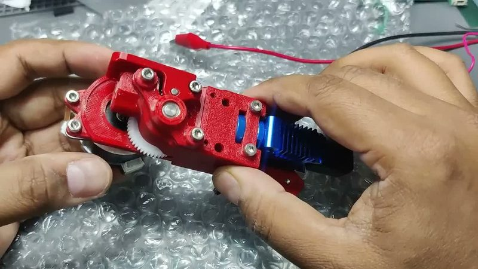
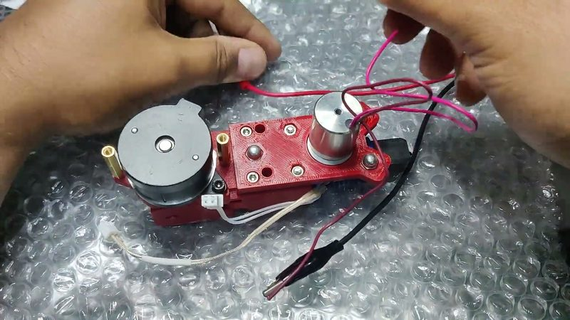
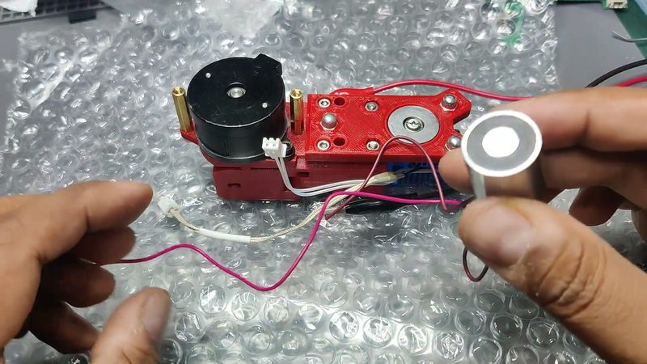
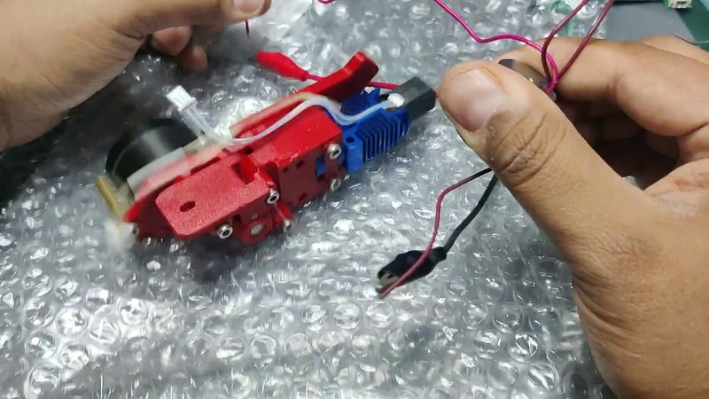

# Vijaya toolchanger

[Catalog row](../../OTHER.md#vijaya-toolchanger) · [Gallery](../../GALLERY.md)

| Field | Value |
| --- | --- |
| Section | Concepts and prototypes ([OTHER.md](../../OTHER.md)) |
| Project page | [https://www.youtube.com/watch?v=8qZWVmBb7m0](https://www.youtube.com/watch?v=8qZWVmBb7m0) |
| Author | DoTheDIY (GitHub apoorv1in) |
| About | A small toolchanger where a permanent electromagnet holds the tool. Power is needed only to release it, so a power cut does not drop the tool and the magnet does not heat. It includes a piezo Z-probe. |
| Type | Tool changer |
| Status | Bench tests, no files |
| Coupling | — |
| Lock | permanent electromagnet |
| Latest version | Last seen [2024-06](https://www.youtube.com/watch?v=8qZWVmBb7m0) |
| Stars Likes Views | [⏯️⁠8.5K](https://www.youtube.com/watch?v=8qZWVmBb7m0) |
| Links | [Video](https://www.youtube.com/watch?v=8qZWVmBb7m0) [Video (piezo Z-probe)](https://www.youtube.com/watch?v=lcpa8969MFk) |

## Pictures (4)

<table>
<tr><td align="center" width="33%"> Photo: <a href="https://www.youtube.com/watch?v=8qZWVmBb7m0">DoTheDIY</a></td><td align="center" width="33%"> Photo: <a href="https://www.youtube.com/watch?v=8qZWVmBb7m0&amp;t=20s">DoTheDIY</a></td><td align="center" width="33%"> Photo: <a href="https://www.youtube.com/watch?v=8qZWVmBb7m0&amp;t=1s">DoTheDIY</a></td></tr>
<tr><td align="center" width="33%"> Photo: <a href="https://www.youtube.com/watch?v=8qZWVmBb7m0&amp;t=28s">DoTheDIY</a></td></tr>
</table>
