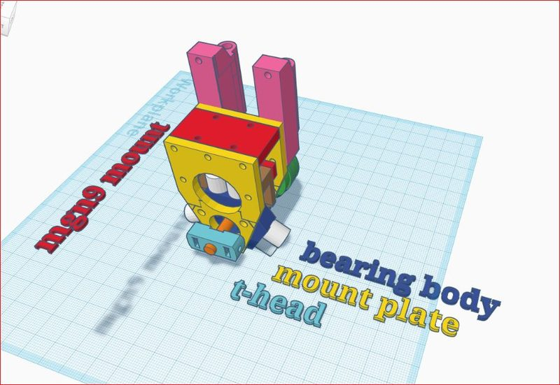
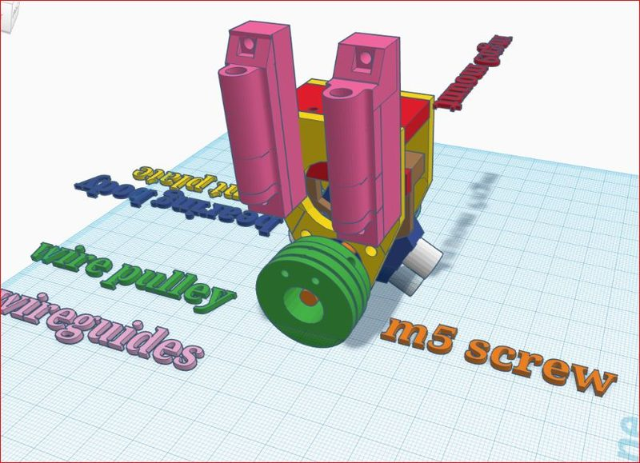
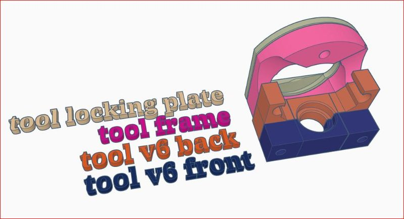
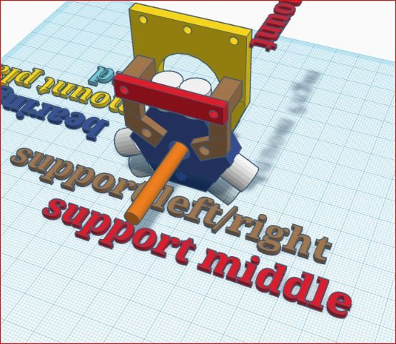

# 3D-printed toolchanger (vladbabii)

[Catalog row](../../OTHER.md#vladbabii-toolchanger) · [Gallery](../../GALLERY.md)

| Field | Value |
| --- | --- |
| Section | Concepts and prototypes ([OTHER.md](../../OTHER.md)) |
| Project page | [https://github.com/vladbabii/3d_printed_toolchanger](https://github.com/vladbabii/3d_printed_toolchanger) |
| Author | Vlad Babii (vladbabii / wladq66 on Thingiverse) |
| About | Fully printed toolchanger with a T-head and locking-plate tool interface, an MGN9 carriage mount, a magnetic tool park and V6/z-probe tools. Klipper macros handle pickup and park. |
| Type | Tool changer |
| Status | Renders and macros, no build |
| Coupling | — |
| Lock | — |
| Latest version | CAD [2019-10](https://github.com/vladbabii/3d_printed_toolchanger/commit/7f6c84d910ad4e8caeae0a7a764fc6d35bb51c4a) |
| Stars Likes Views |  |
| Links | [STL](https://github.com/vladbabii/3d_printed_toolchanger) [CAD](https://www.tinkercad.com/things/gzwL8Fvx3js) [Config](https://github.com/vladbabii/3d_printed_toolchanger/tree/master/macros/toolchanger_v3) [Files](https://www.thingiverse.com/thing:3937608) |

## Pictures (4)

<table>
<tr><td align="center" width="33%"> Photo: <a href="https://github.com/vladbabii/3d_printed_toolchanger">vladbabii</a></td><td align="center" width="33%"> Photo: <a href="https://github.com/vladbabii/3d_printed_toolchanger">vladbabii</a></td><td align="center" width="33%"> Photo: <a href="https://github.com/vladbabii/3d_printed_toolchanger">vladbabii</a></td></tr>
<tr><td align="center" width="33%"> Photo: <a href="https://github.com/vladbabii/3d_printed_toolchanger">vladbabii</a></td></tr>
</table>
