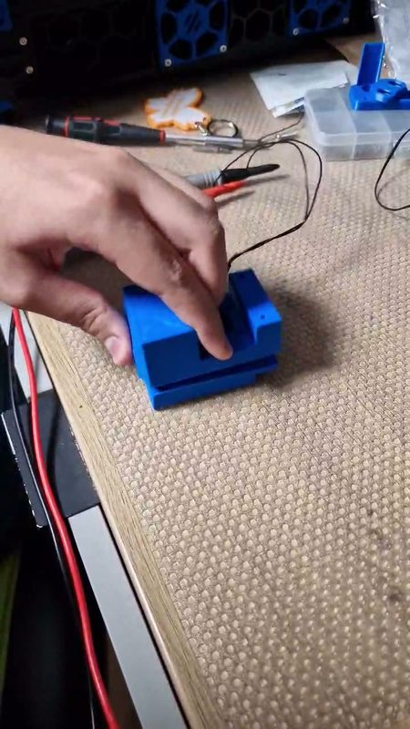
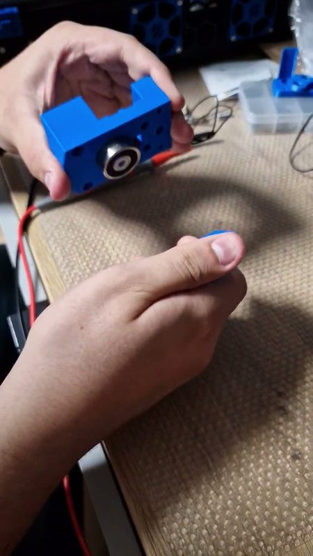

# Voron MagChange

[Catalog row](../../OTHER.md#voron-magchange) · [Gallery](../../GALLERY.md)

| Field | Value |
| --- | --- |
| Section | Concepts and prototypes ([OTHER.md](../../OTHER.md)) |
| Project page | [https://github.com/BlackShadeOSS/Voron-MagChange](https://github.com/BlackShadeOSS/Voron-MagChange) |
| Author | BlackShadeOSS (BlackShade) |
| About | Coupling plate for Voron. A 24 V electromagnet (25x11 mm) on the carriage holds the tool plate, which sits on a Kelvin coupling of cup-head nuts. A microswitch detects a mounted tool. |
| Type | Tool changer |
| Status | Coupling plate only |
| Coupling | Kelvin (M3 cup-head nuts DIN1587) |
| Lock | electromagnet |
| Latest version | STEP [2023-09](https://github.com/BlackShadeOSS/Voron-MagChange/commit/d48678e3b1879300fc345d5f3a4bb8634bb73401) |
| Stars Likes Views |  |
| Links | [STEP](https://github.com/BlackShadeOSS/Voron-MagChange/tree/main/STEP) [STL](https://github.com/BlackShadeOSS/Voron-MagChange/tree/main/STL) [BOM](https://github.com/BlackShadeOSS/Voron-MagChange#bom) |

## Pictures (2)

<table>
<tr><td align="center" width="33%"> Photo: <a href="https://github.com/BlackShadeOSS/Voron-MagChange">BlackShade (BlackShadeOSS)</a></td><td align="center" width="33%"> Photo: <a href="https://github.com/BlackShadeOSS/Voron-MagChange">BlackShade (BlackShadeOSS)</a></td></tr>
</table>
