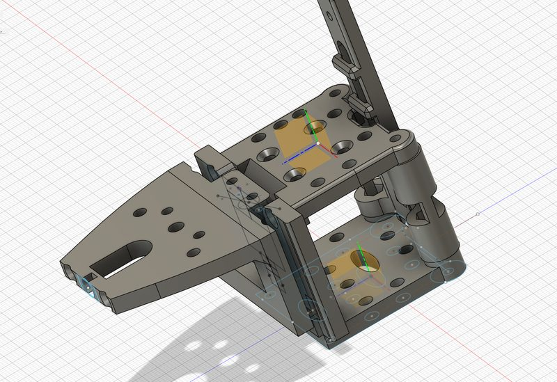

# ToolChanger VZbot.basis

[Catalog row](../../OTHER.md#vzbot-basis-toolchanger) · [Gallery](../../GALLERY.md)

| Field | Value |
| --- | --- |
| Section | Not in the catalog ([OTHER.md](../../OTHER.md)) |
| Project page | [https://www.printables.com/model/1125546-toolchanger-vzbotbasis](https://www.printables.com/model/1125546-toolchanger-vzbotbasis) |
| Author | Michael-3d |
| Type | Not a changer |
| Reason | No dock. As published, it is a manual magnetic quick-swap plate. |
| Coupling | dowel pins |
| Lock | magnets |
| Latest version | Last seen [2024-12](https://www.printables.com/model/1125546-toolchanger-vzbotbasis) |
| Links | [Files](https://www.printables.com/model/1125546-toolchanger-vzbotbasis/files) |

## Pictures (1)

<table>
<tr><td align="center" width="33%"> Photo: <a href="https://www.printables.com/model/1125546-toolchanger-vzbotbasis">Michael-3d</a></td></tr>
</table>
