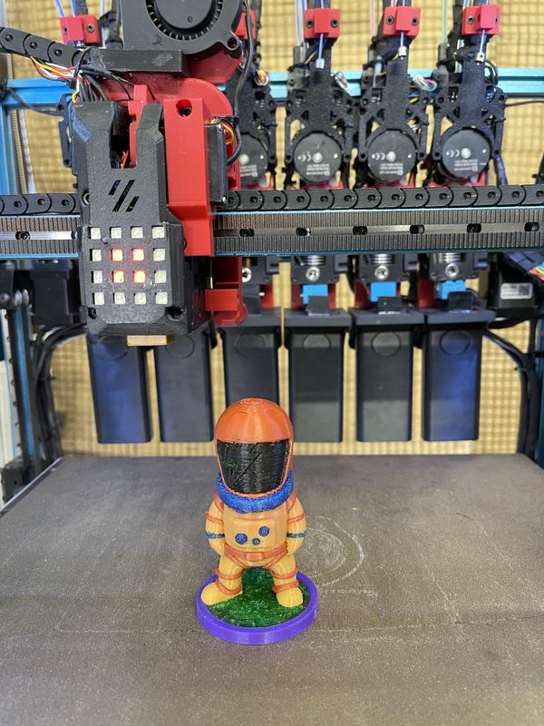
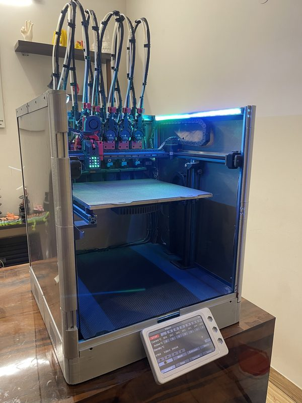
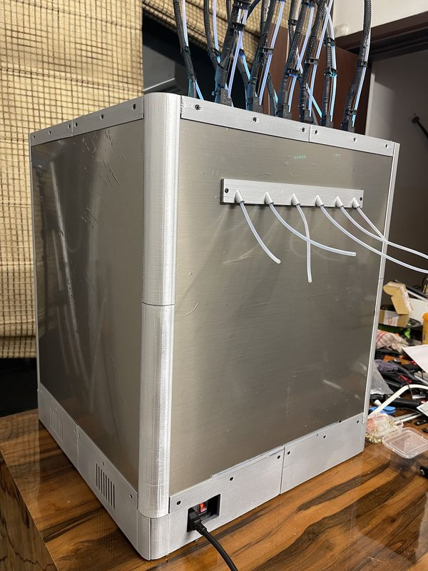
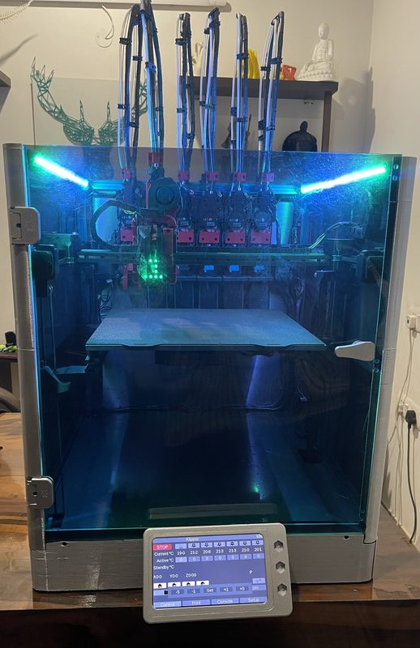
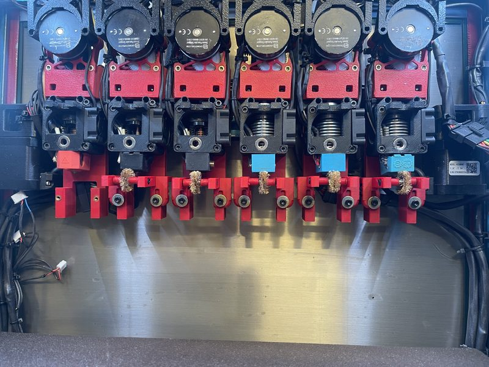
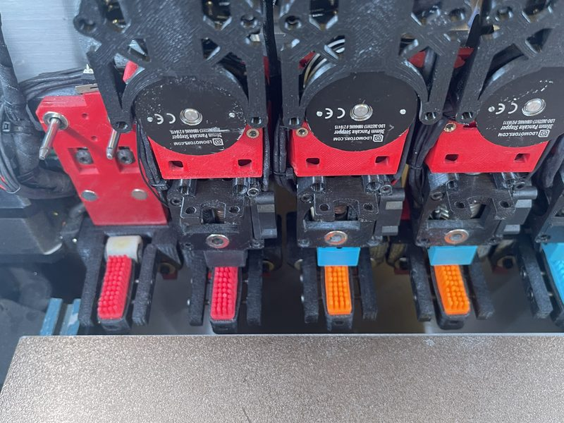
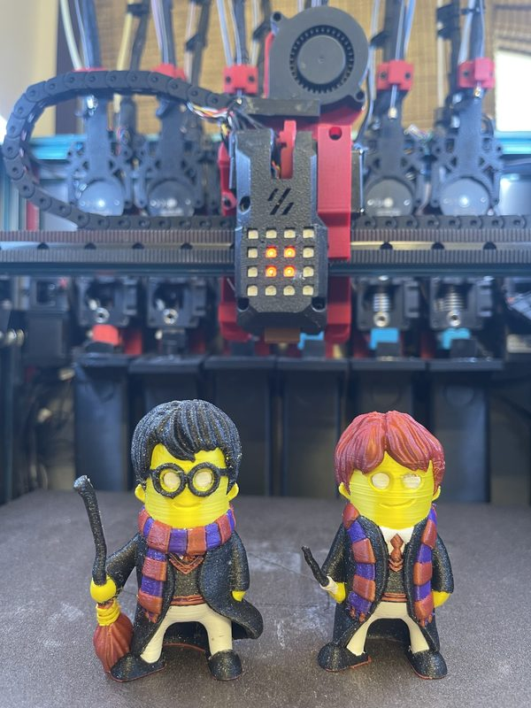
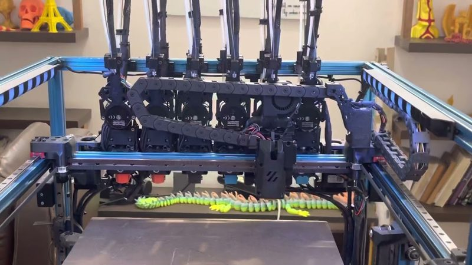
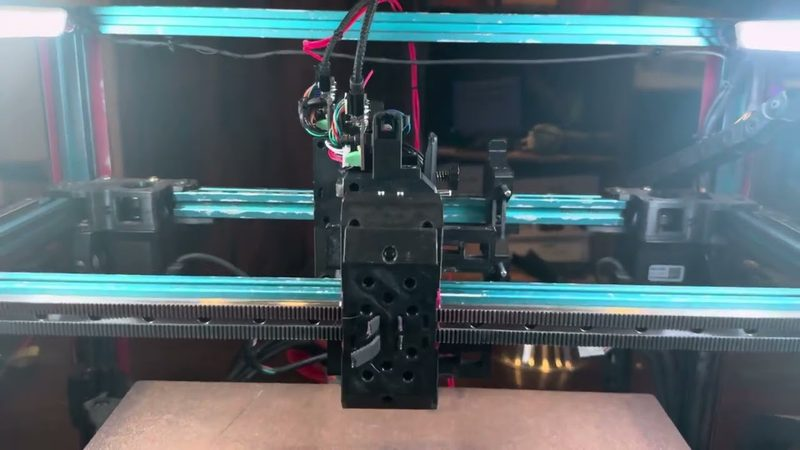
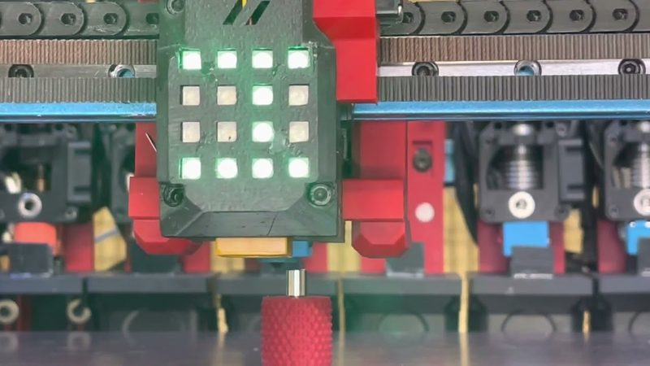

# WP-DAKSH

[Catalog row](../../README.md#wp-daksh) · [Gallery](../../GALLERY.md)

| Field | Value |
| --- | --- |
| Section | Legacy designs |
| Project page | [https://github.com/ankurv2k6/wp-daksh-toolchanger](https://github.com/ankurv2k6/wp-daksh-toolchanger) |
| Author | Ankur Verma (3D Unplugged) |
| About | Earlier fully printed DAKSH generation for a Voron Trident. A single servo turns a camshaft that locks the tool. Nozzle wiper on the dock and a 4x4 LED matrix on the toolhead. No update since 2023-03. |
| Type | Tool changer |
| Coupling | — |
| Lock | cam, servo |
| Change time | [~10 s](https://github.com/ankurv2k6/wp-daksh-toolchanger) |
| Latest version | STL [2023-03](https://github.com/ankurv2k6/wp-daksh-toolchanger/commit/a113e4f) |
| Stars Likes Views |  [🧡⁠100](https://www.printables.com/model/565264-wp-daksh-3d-printed-tool-changer) [⏯️⁠60.8K](https://www.youtube.com/watch?v=1WqDcpxC3-o) |
| Links | [STL](https://github.com/ankurv2k6/wp-daksh-toolchanger/tree/main/STL) [CAD](https://github.com/ankurv2k6/wp-daksh-toolchanger/tree/main/CAD) [Config](https://github.com/ankurv2k6/wp-daksh-toolchanger/tree/main/firmware/config) [BOM](https://docs.google.com/spreadsheets/d/12ISdJoCqgUTPsUwRrQ3VZWM-GBWw20C0cgHo7VGqMWU) [Files](https://www.printables.com/model/565264-wp-daksh-3d-printed-tool-changer) [Video](https://www.youtube.com/watch?v=1WqDcpxC3-o) |
| Groups | [Discord](https://discord.gg/Kz9VC8rWPg) EN 1.3K |

## Pictures (10)

<table>
<tr><td align="center" width="33%"> Photo: <a href="https://github.com/ankurv2k6/wp-daksh-toolchanger">Ankur Verma</a></td><td align="center" width="33%"> Photo: <a href="https://github.com/ankurv2k6/wp-daksh-toolchanger">Ankur Verma</a></td><td align="center" width="33%"> Photo: <a href="https://github.com/ankurv2k6/wp-daksh-toolchanger">Ankur Verma</a></td></tr>
<tr><td align="center" width="33%"> Photo: <a href="https://github.com/ankurv2k6/wp-daksh-toolchanger">Ankur Verma</a></td><td align="center" width="33%"> Photo: <a href="https://github.com/ankurv2k6/wp-daksh-toolchanger">Ankur Verma</a></td><td align="center" width="33%"> Photo: <a href="https://github.com/ankurv2k6/wp-daksh-toolchanger">Ankur Verma</a></td></tr>
<tr><td align="center" width="33%"> Photo: <a href="https://github.com/ankurv2k6/wp-daksh-toolchanger">Ankur Verma</a></td><td align="center" width="33%"> Photo: <a href="https://www.youtube.com/watch?v=1WqDcpxC3-o">Ankur Verma</a></td><td align="center" width="33%"> Photo: <a href="https://www.youtube.com/watch?v=v6QG2y4h36s">Ankur Verma</a></td></tr>
<tr><td align="center" width="33%"> Photo: <a href="https://www.youtube.com/watch?v=ppcTm3NfDo0">Ankur Verma</a></td></tr>
</table>
