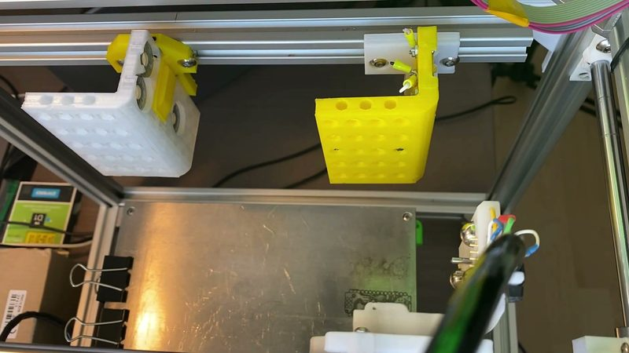
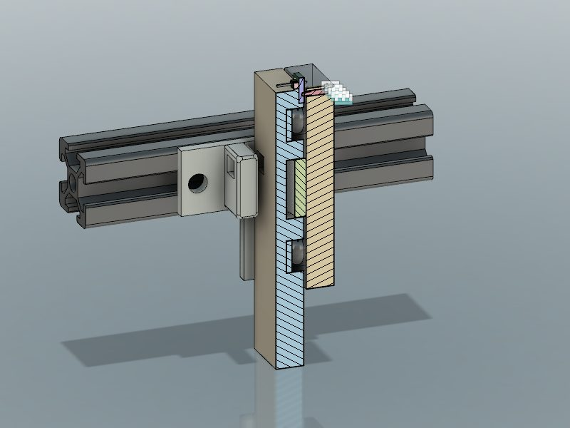
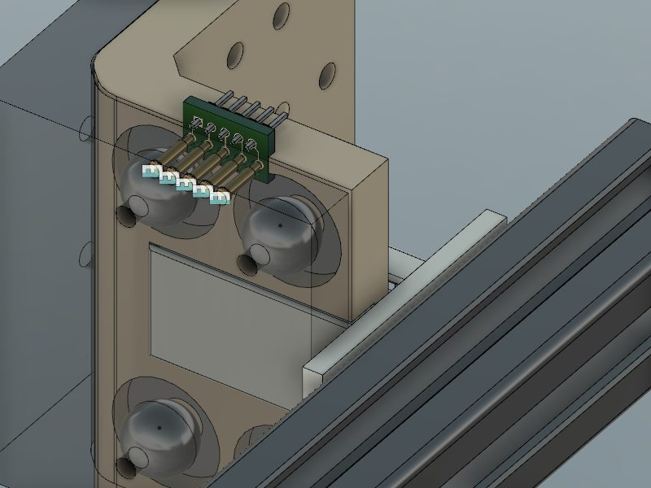
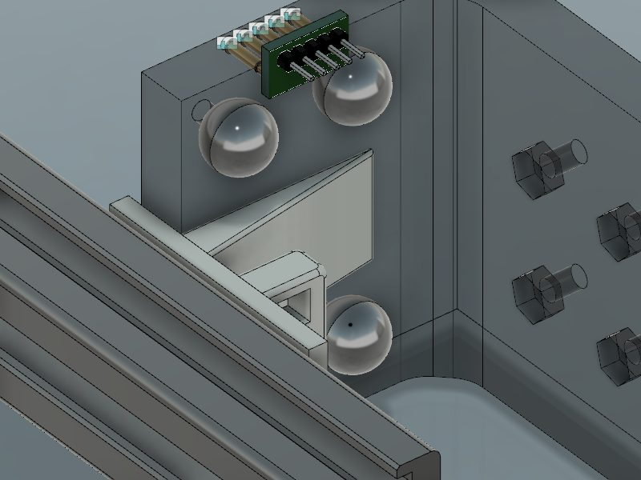
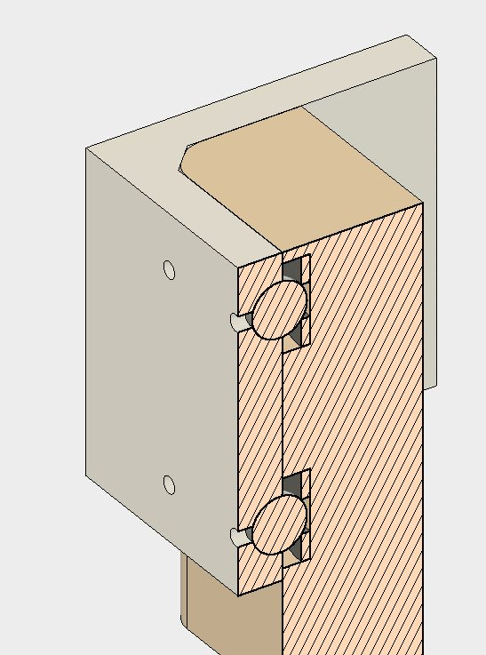
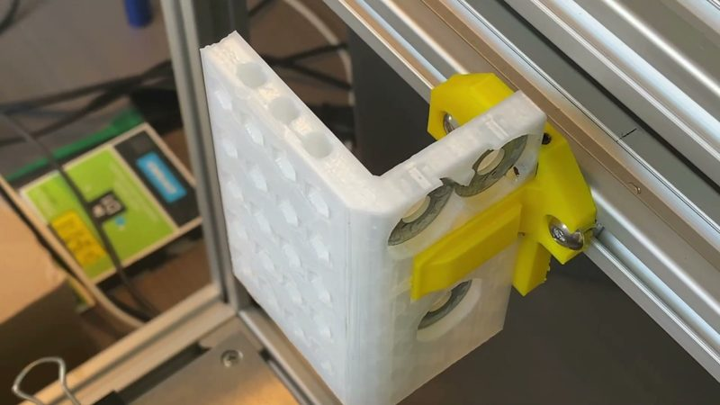
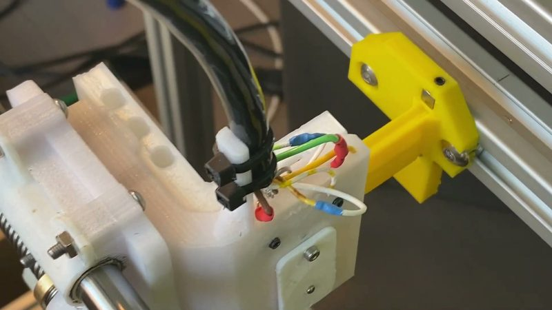
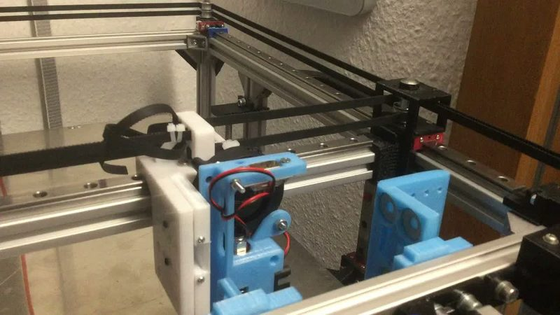
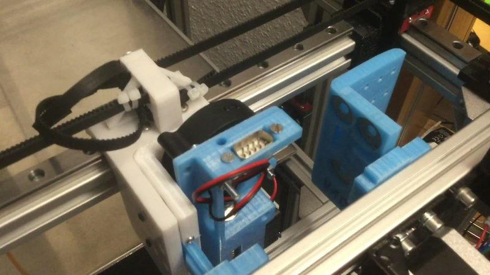
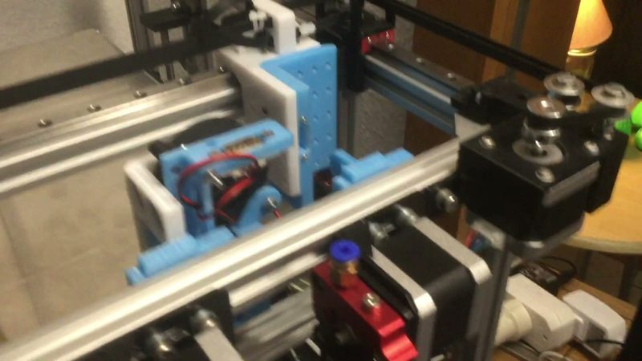

# XHTC

[Catalog row](../../OTHER.md#xhtc) · [Gallery](../../GALLERY.md)

| Field | Value |
| --- | --- |
| Section | Legacy designs ([OTHER.md](../../OTHER.md)) |
| Project page | [https://github.com/xpix/XHTC](https://github.com/xpix/XHTC) |
| Author | Frank Herrmann (xpix) |
| About | Automatic tool changer for a Hypercube, based on René Jurack's design. Magnets hold the tool, and pogo pins make all tool connections in one move. OctoPrint before/after toolchange scripts drive the change. No update since 2018-04. |
| Type | Tool changer |
| Coupling | — |
| Lock | magnets |
| Change time | — |
| Latest version | First release [2018-04](https://github.com/xpix/XHTC) |
| Stars Likes Views |  [⏯️⁠4K](https://www.youtube.com/watch?v=xUQaVA273kA) |
| Links | [CAD](https://a360.co/2DpOXs6) [CAD (extruder module)](https://a360.co/31B6Dh0) [CAD (magnet holder)](https://a360.co/2JZUHQm) [FW](https://github.com/xpix/Marlin) [Config](https://github.com/xpix/XHTC/blob/master/toolchange_before.tmpl) [PCB](https://oshpark.com/shared_projects/ypHD6yYr) [Video](https://www.youtube.com/watch?v=tmCkdqE2O68) |
| Groups | — |

## Pictures (10)

<table>
<tr><td align="center" width="33%"> Photo: <a href="https://www.youtube.com/watch?v=1Jcus5Uca6A">xpix</a></td><td align="center" width="33%"> Photo: <a href="https://reprap.org/forum/read.php?245,789306,802669#msg-802669">xpix</a></td><td align="center" width="33%"> Photo: <a href="https://reprap.org/forum/read.php?245,789306,802669#msg-802669">xpix</a></td></tr>
<tr><td align="center" width="33%"> Photo: <a href="https://reprap.org/forum/read.php?245,789306,802669#msg-802669">xpix</a></td><td align="center" width="33%"> Photo: <a href="https://reprap.org/forum/read.php?245,789306,802113#msg-802113">xpix</a></td><td align="center" width="33%"> Photo: <a href="https://www.youtube.com/watch?v=1Jcus5Uca6A">xpix</a></td></tr>
<tr><td align="center" width="33%"> Photo: <a href="https://www.youtube.com/watch?v=1Jcus5Uca6A">xpix</a></td><td align="center" width="33%"> Version: GeitPrinter ToolChanger Photo: <a href="https://www.youtube.com/watch?v=fZJShQEbW1U">GeitAtHome</a></td><td align="center" width="33%"> Version: GeitPrinter ToolChanger Photo: <a href="https://www.youtube.com/watch?v=fZJShQEbW1U&amp;t=30s">GeitAtHome</a></td></tr>
<tr><td align="center" width="33%"> Version: GeitPrinter ToolChanger Photo: <a href="https://www.youtube.com/watch?v=fZJShQEbW1U&amp;t=45s">GeitAtHome</a></td></tr>
</table>

## Ports and variants

- [GeitPrinter ToolChanger](https://www.youtube.com/watch?v=fZJShQEbW1U), *GeitAtHome (geit_de)*. A 500 mm 2020-extrusion printer with a magnetic toolchanger based on the XHTC docking mechanism by Frank Herrmann (xpix), redesigned in FreeCAD and not compatible with it. Each enclosed E3D V6 tool connects through a Sub-D 9 connector, with Bowden extruders mounted on the frame.
