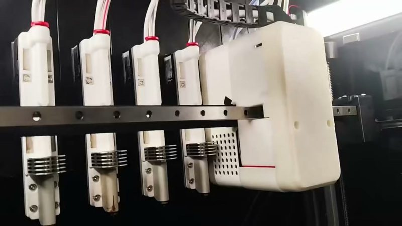
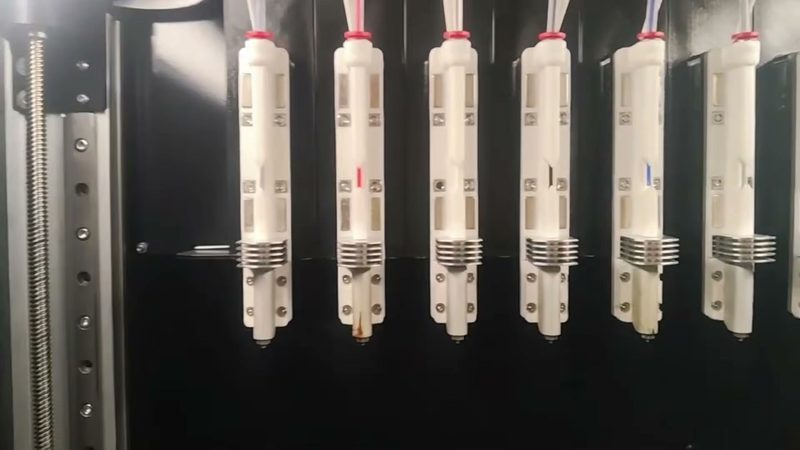
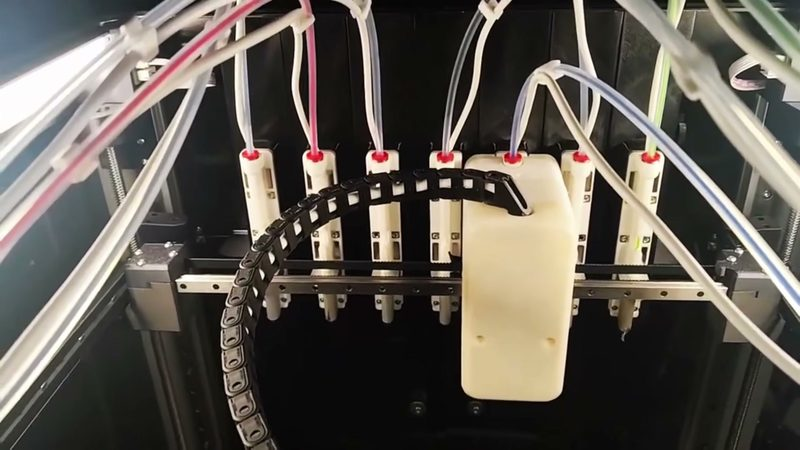
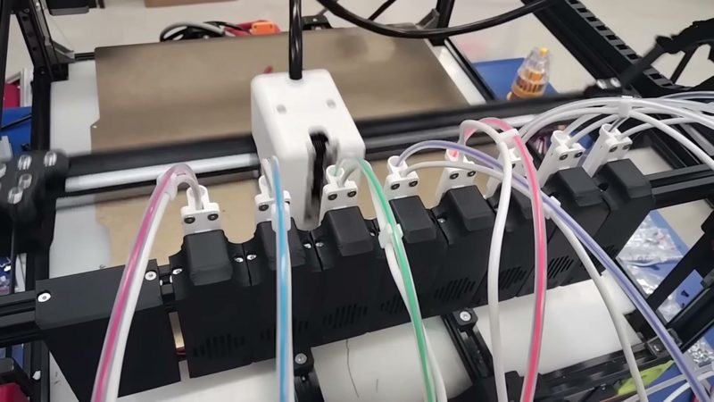
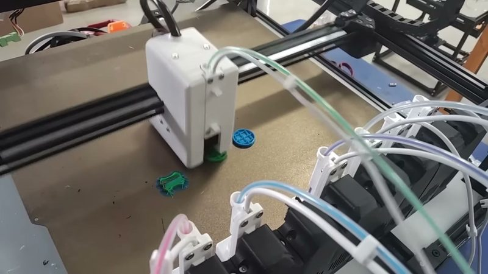
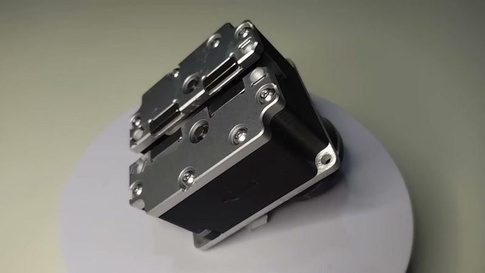
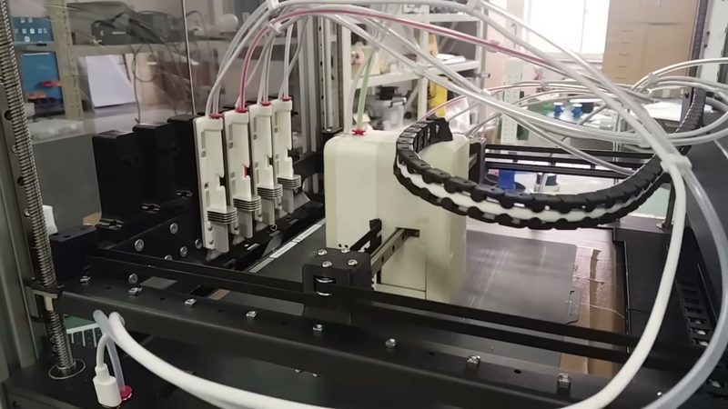
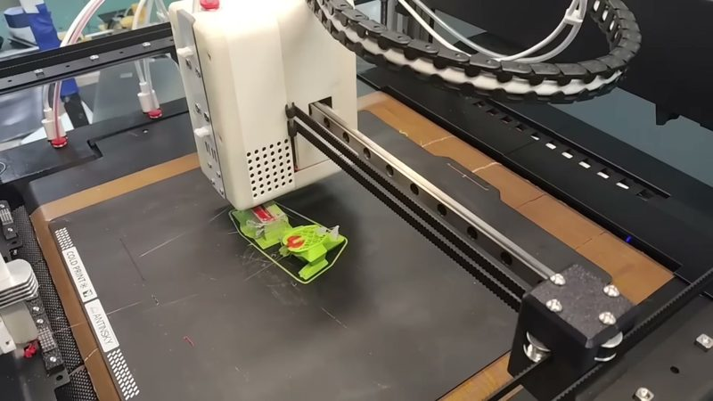
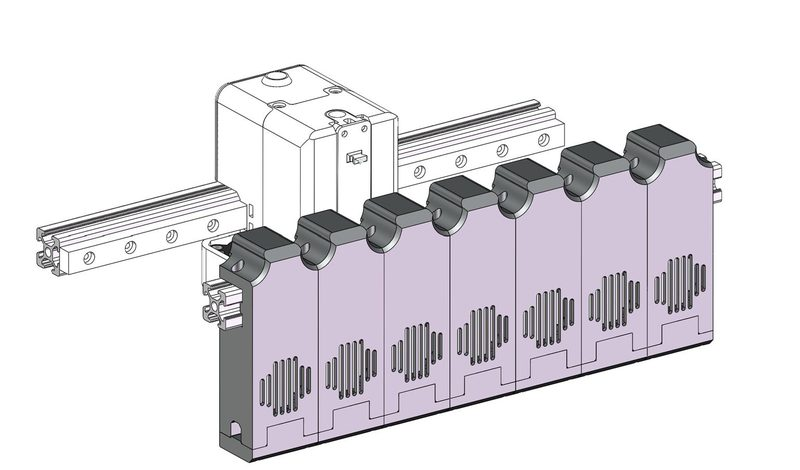
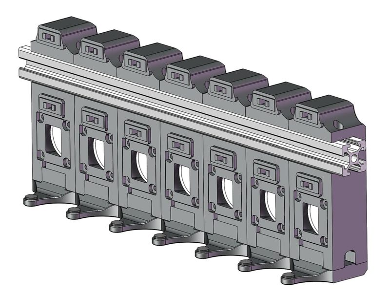

# YUDX

[Catalog row](../../README.md#yudx) · [Gallery](../../GALLERY.md)

| Field | Value |
| --- | --- |
| Section | Hotend changers |
| Project page | [https://github.com/dumplinglab/YUDX-tool-changer](https://github.com/dumplinglab/YUDX-tool-changer) |
| Author | dumpling lab (dumplinglab) |
| About | INDX-inspired hotend changer: a one-way-bearing dock mechanism and a shared spring-and-gear 'dynamic extruder' on the head give about 1 s changes. Tools are Bambu hotends that can preheat while parked. The 2026.10 revision makes the Maxwell coupling clamp tighter as extrusion force rises. |
| Coupling | Maxwell |
| Lock | push latch, the dock works it |
| Change time | [~1 s](https://github.com/dumplinglab/YUDX-tool-changer) |
| Tools | 7 |
| Printer | CoreXY, any gantry |
| Firmware | RepRapFirmware, Klipper |
| Latest version | CAD [2026-10](https://github.com/dumplinglab/YUDX-tool-changer/commit/52e8ef6) |
| Stars Likes Views |  [⏯️⁠54.1K](https://www.youtube.com/watch?v=Vm4MIgcpSWI) |
| Links | [STEP](https://github.com/dumplinglab/YUDX-tool-changer/tree/main/CAD) [STL](https://github.com/dumplinglab/YUDX-tool-changer/tree/main/STLs) [CAD](https://github.com/dumplinglab/YUDX-tool-changer/tree/main/CNC%20Parts) [BOM](https://github.com/dumplinglab/YUDX-tool-changer/blob/main/BOM.xlsx) [Manual](https://github.com/dumplinglab/YUDX-tool-changer/blob/main/YUDX%20Assembly%20Instruction.pdf) [Config](https://github.com/dumplinglab/YUDX-tool-changer/tree/main/Gcode/RepRapFirmware) [Video](https://www.youtube.com/watch?v=Vm4MIgcpSWI) |
| Groups | [Discord](https://discord.gg/huHw8kzNXp) EN 1.1K |

## Pictures (10)

<table>
<tr><td align="center" width="33%"> Photo: <a href="https://www.youtube.com/watch?v=G3__Ysn6-TI">dumpling lab</a></td><td align="center" width="33%"> Photo: <a href="https://www.youtube.com/watch?v=G3__Ysn6-TI">dumpling lab</a></td><td align="center" width="33%"> Photo: <a href="https://www.youtube.com/watch?v=G3__Ysn6-TI">dumpling lab</a></td></tr>
<tr><td align="center" width="33%"> Photo: <a href="https://www.youtube.com/watch?v=Vm4MIgcpSWI">dumpling lab</a></td><td align="center" width="33%"> Photo: <a href="https://www.youtube.com/watch?v=Vm4MIgcpSWI">dumpling lab</a></td><td align="center" width="33%"> Photo: <a href="https://www.youtube.com/watch?v=Vm4MIgcpSWI">dumpling lab</a></td></tr>
<tr><td align="center" width="33%"> Photo: <a href="https://www.youtube.com/watch?v=Vm4MIgcpSWI">dumpling lab</a></td><td align="center" width="33%"> Photo: <a href="https://www.youtube.com/watch?v=Vm4MIgcpSWI">dumpling lab</a></td><td align="center" width="33%"> Photo: <a href="https://github.com/dumplinglab/YUDX-tool-changer">dumpling lab</a></td></tr>
<tr><td align="center" width="33%"> Photo: <a href="https://github.com/dumplinglab/YUDX-tool-changer">dumpling lab</a></td></tr>
</table>

## Notes

- On Bilibili the author is 饺子馅的3D打印小屋 and calls the changer 聿. [The first video](https://www.bilibili.com/video/BV11FSBB6E7w/) (2025-11) shows the first version, with 7 hotends on the author's own frame. [The second video](https://www.bilibili.com/video/BV1Sug76xE7s/) (2026-08) shows the inside of the extruder.
- Printers that the author names: Voron 2.4, Voron Trident. ([source](https://github.com/dumplinglab/YUDX-tool-changer))

## Builds by other people

- [YUDX on a BBox test chassis](https://youtube.com/shorts/fybG1eVXkew), *sakitume (Sakitume Makes)*. 2026-10.
