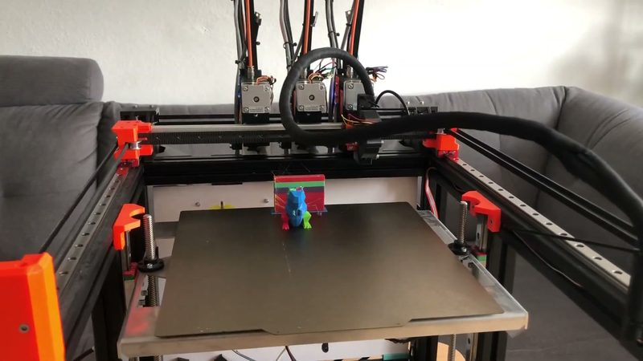
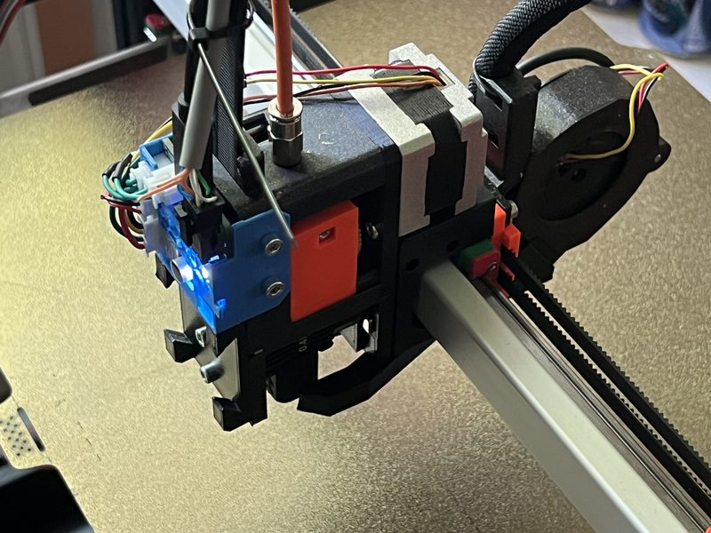
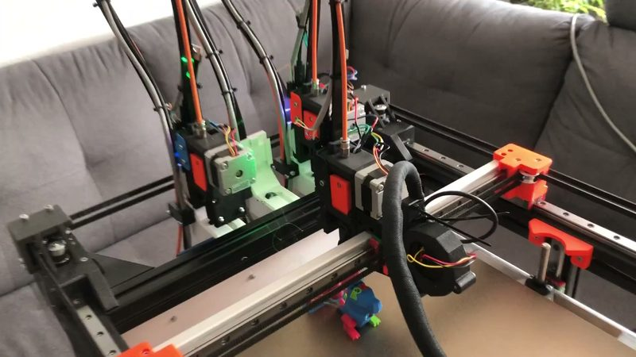
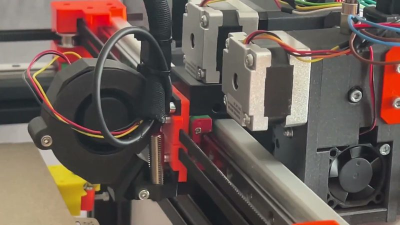
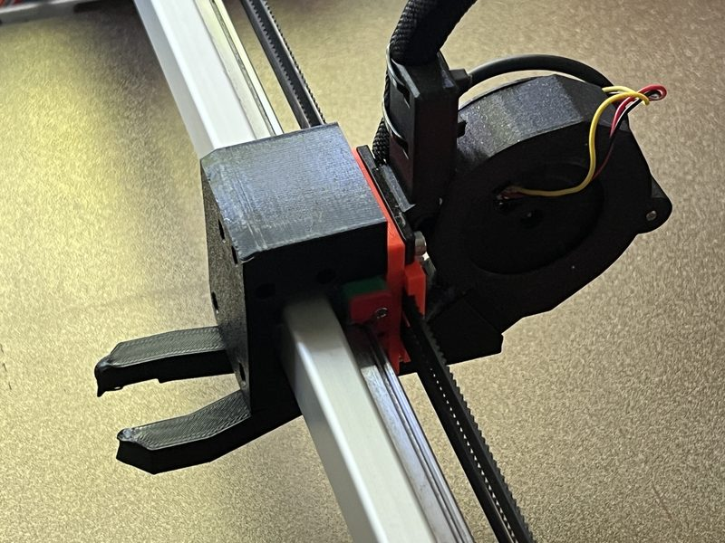
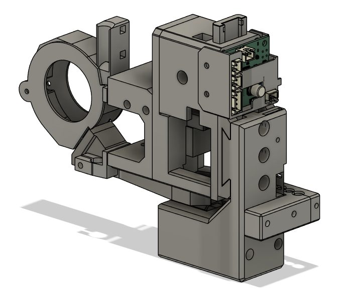

# ZdeHav Magnetic Toolchanger

[Catalog row](../../README.md#zdehav-changer) · [Gallery](../../GALLERY.md)

| Field | Value |
| --- | --- |
| Section | Tool changers |
| Project page | [https://github.com/iZboxo/ZdeHav-Changer](https://github.com/iZboxo/ZdeHav-Changer) |
| Author | iZboxo (Zdeněk Havlát, ZdeHav) |
| About | Three cap nuts on the tool sit in three hex nuts on the carriage, and magnets hold the tool on the carriage and in the dock. Each tool has its own NEMA 14 extruder and a Bambu X1C hotend. The author's CAN toolhead board needs one cable per tool. |
| Coupling | cap nuts in hex nuts |
| Lock | magnets |
| Extruder | on the tool |
| Change time | [4.7 s](https://www.youtube.com/watch?v=-MmCY37FF60&t=28s) |
| Tools | 3 |
| Printer | — |
| Firmware | Klipper |
| Latest version | STEP [2026-05](https://github.com/iZboxo/ZdeHav-Changer/commit/3dd9a2f7bad247054bffe6d8fcf5d50fb235dd02) |
| Stars Likes Views |  [⏯️⁠415](https://www.youtube.com/watch?v=-MmCY37FF60) |
| Links | [STEP](https://github.com/iZboxo/ZdeHav-Changer/blob/main/ZdeHavChanger.step) [PCB](https://github.com/iZboxo/ZdeHav-Changer-PCB) [PCB BOM](https://izboxo.github.io/ZdeHav-Changer-PCB/bom/ibom.html) [Video](https://www.youtube.com/watch?v=-MmCY37FF60) |
| Groups | — |

## Pictures (6)

<table>
<tr><td align="center" width="33%"> Photo: <a href="https://www.youtube.com/watch?v=-MmCY37FF60">ZdeHav</a></td><td align="center" width="33%"> Photo: <a href="https://github.com/iZboxo/ZdeHav-Changer">iZboxo</a></td><td align="center" width="33%"> Photo: <a href="https://www.youtube.com/watch?v=-MmCY37FF60">ZdeHav</a></td></tr>
<tr><td align="center" width="33%"> Photo: <a href="https://www.youtube.com/watch?v=-MmCY37FF60">ZdeHav</a></td><td align="center" width="33%"> Photo: <a href="https://github.com/iZboxo/ZdeHav-Changer">iZboxo</a></td><td align="center" width="33%"> Photo: <a href="https://github.com/iZboxo/ZdeHav-Changer">iZboxo</a></td></tr>
</table>

## Notes

- [The Cheapest ToolChanger](../cheapest-toolchanger/README.md) (2025-05) is an earlier design by the same author.
